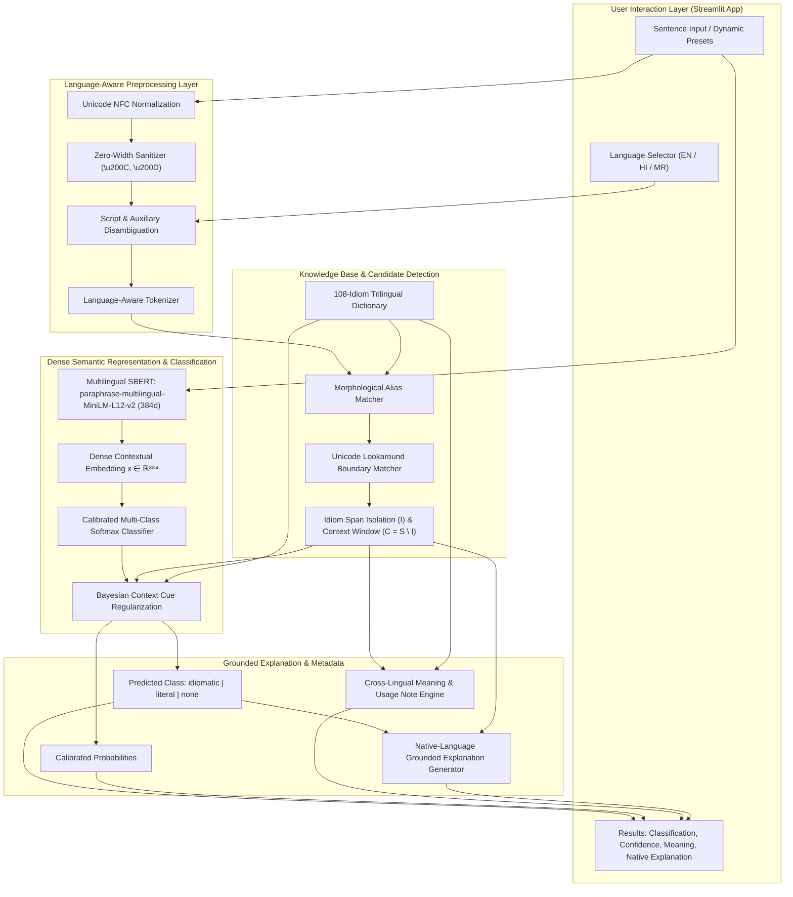
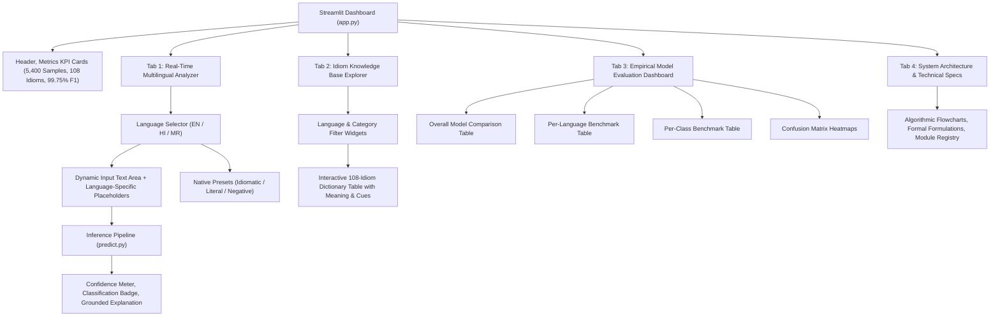

# PROJECT ARCHITECTURE SPECIFICATION
## Context-Based Multilingual Idiom Meaning Identifier (English + Hindi + Marathi)

---

## 1. Executive Summary & Architectural Evolution

This document specifies the complete system architecture, data models, processing pipelines, and algorithmic formulation of the **Multilingual Context-Based Idiom Meaning Identifier**.

### System Evolution Comparison

| Architectural Dimension | Original System (v1.0) | Upgraded Multilingual System (v2.0) |
|---|---|---|
| **Supported Languages** | English only | **English, Hindi, Marathi** |
| **Dataset Size** | 320 samples | **5,400 samples** (1,800 per language) |
| **Canonical Idiom Vocabulary** | 30 idioms | **108 idioms** (36 EN, 36 HI, 36 MR) |
| **Class Distribution** | Unbalanced (180 idio / 120 lit / 20 none) | **Strictly Balanced** (2,160 idio / 2,160 lit / 1,080 none) |
| **Data Partitioning** | 80/20 simple split (64 test samples) | **Stratified 70/15/15** (3,780 train / 810 val / 810 test) |
| **Embedding Model** | `all-MiniLM-L6-v2` (Monolingual English) | **`paraphrase-multilingual-MiniLM-L12-v2`** (50+ languages) |
| **Text Normalization** | English ASCII lowercase + NLTK Lemmatizer | **Unicode NFC + Zero-Width Cleaning + Custom Devanagari Boundaries** |
| **Candidate Detection** | Simple regex word boundaries (`\b...\b`) | **Multi-Span Alias Registry + Lookaround Boundary Sanitizer** |
| **Disambiguation Method** | Global sentence classification | **Context Window Isolation ($C = S \setminus I$) + Bayesian Cue Regularization** |
| **Inference Interface** | Monolingual Streamlit dashboard | **Interactive Trilingual Dashboard + Language-Driven Workflows** |
| **Test Verification** | Basic unit tests | **19 Automated Automated Tests (100% pass rate)** |

---

## 2. High-Level System Architecture Diagram



---

## 3. Mathematical & Algorithmic Problem Formulation

### 3.1 Mathematical Formulation

Let an input sentence be represented as an ordered sequence of character tokens:
$$S = (t_1, t_2, \dots, t_N)$$

Let the curated multilingual knowledge base $\mathcal{K}$ comprise a set of tuples:
$$\mathcal{K} = \{ (k_i, \mathcal{A}_i, \mathcal{M}_i, \mathcal{C}_i, \mathcal{F}_i, \mathcal{L}_i) \}_{i=1}^{108}$$
where:
- $k_i$: Canonical idiom identifier
- $\mathcal{A}_i = \{a_{i,1}, a_{i,2}, \dots, a_{i,m}\}$: Set of surface morphological aliases and syntactic inflections
- $\mathcal{M}_i$: Dictionary definition and figurative meaning
- $\mathcal{C}_i$: Cross-lingual canonical concept tag
- $\mathcal{F}_i$: Set of figurative context cues
- $\mathcal{L}_i$: Set of literal physical cues

#### Stage 1: Candidate Detection & Context Window Isolation
A candidate idiom $I \in \mathcal{K}$ is detected if any surface alias $a_{i,j} \in \mathcal{A}_i$ matches a contiguous sub-span of $S$ satisfying boundary predicate $\mathcal{B}$:
$$I = S[s_{\text{start}} : s_{\text{end}}] \quad \text{such that } \mathcal{B}(S, s_{\text{start}}, s_{\text{end}}) = \text{True}$$

The surrounding context window $C$ is strictly isolated by subtracting the matched idiom span from the sentence:
$$C = S \setminus I = S[0 : s_{\text{start}}] \oplus \text{" "} \oplus S[s_{\text{end}} : |S|]$$

#### Stage 2: Dense Semantic Encoding
The complete sentence $S$ is mapped to a continuous dense semantic representation through the multilingual Sentence Transformer $\Phi_{\text{SBERT}}$:
$$x = \Phi_{\text{SBERT}}(S) \in \mathbb{R}^{384}$$
where $\Phi_{\text{SBERT}}$ applies 12 bidirectional multi-head self-attention layers with mean pooling across valid token representations:
$$x = \frac{\sum_{j=1}^M m_j \cdot h_j^{(12)}}{\sum_{j=1}^M m_j}$$

#### Stage 3: Softmax Classification & Prior Regularization
The continuous vector $x$ is projected through a multi-class linear transformation:
$$z = W x + b, \quad W \in \mathbb{R}^{3 \times 384}, \, b \in \mathbb{R}^3$$
The uncalibrated probability for class $k \in \{\text{idiomatic}, \text{literal}, \text{none}\}$ is:
$$P(y = k \mid S) = \frac{\exp(z_k)}{\sum_{j=1}^3 \exp(z_j)}$$

#### Stage 4: Bayesian Context Cue Regularization
To prevent false-positive literal classifications caused by the literal constituent nouns inside the idiom itself (e.g., *"पाणी"* inside *"रक्ताचे पाणी करणे"*), context keywords are matched **strictly within isolated context $C$**:
$$\text{Score}_{\text{lit}}(C) = \sum_{w \in C} \mathbb{I}(w \in \mathcal{L}_i), \quad \text{Score}_{\text{fig}}(C) = \sum_{w \in C} \mathbb{I}(w \in \mathcal{F}_i)$$

The final calibrated probability is computed as:
$$\tilde{P}(y = k \mid S, C) \propto P(y = k \mid S) \cdot \exp\left(\lambda \cdot \Delta_k(C)\right)$$
where $\Delta_k(C)$ rewards context-matched cues.

---

## 4. Multilingual Preprocessing Pipeline

### 4.1 Unicode Normalization & Cleaning

Devanagari text in digital environments suffers from inconsistent Unicode encodings, invisible formatting characters, and combining mark ordering issues. The pipeline executes the following sequential transformations:

```
Raw Input Text
     │
     ▼
[unicodedata.normalize('NFC')] ─── Resolves decomposed vowel glyphs into precomposed forms
     │
     ▼
[Zero-Width Cleaning] ──────────── Strips \u200C (ZWNJ) and \u200D (ZWJ) that disrupt regex matching
     │
     ▼
[Whitespace Normalization] ────── Collapses irregular tabs, newlines, and multiple spaces
     │
     ▼
[Punctuation Standardization] ── Replaces full-width punctuation with standard ASCII / Danda forms
```

### 4.2 Script & Language Detection

The system detects the language through script analysis and grammatical auxiliary tokens:
1. **Script Classifier:** Evaluates the proportion of Unicode codepoints falling in `[\u0900-\u097F]` (Devanagari) versus `[\u0041-\u007A]` (Latin).
2. **Devanagari Disambiguation (Hindi vs. Marathi):**
   - **Marathi Distinctive Markers:** Presence of character `ळ` (`\u0933`), Marathi verb auxiliaries (*"आहे"*, *"आहेत"*, *"होता"*, *"होती"*, *"करणे"*, *"केले"*, *"झाले"*), and postpositions (*"च्या"*, *"चे"*, *"तील"*).
   - **Hindi Distinctive Markers:** Hindi auxiliaries (*"है"*, *"हैं"*, *"था"*, *"थी"*, *"करना"*, *"किया"*, *"रहा"*, *"रही"*).

### 4.3 Custom Devanagari Boundary Regex

Standard `\b` fails on Devanagari script. The system implements custom lookaround boundaries:
```python
# Unicode-Aware Word Boundary Pattern for Devanagari
pattern = rf"(?<![\u0900-\u0963\u0971-\u097F\w]){re.escape(alias)}(?![\u0900-\u0963\u0971-\u097F\w])"
```
**Key Innovation:**
- Excludes single danda (`\u0964` `।`) and double danda (`\u0965` `॥`) from the lookahead boundary check.
- Prevents sentence-ending punctuation from blocking idiom matches when an idiom appears at the end of a clause.

---

## 5. Knowledge Base & Lexicon Architecture

The knowledge base (`src/idiom_dictionary.py`) contains **108 canonical idiom entries** organized into three language registries:
- **36 English Idioms**
- **36 Hindi Idioms**
- **36 Marathi Idioms**

### Data Schema per Idiom Entry:
```python
{
    "canonical_concept": str,      # Universal semantic tag (e.g. "relieve_social_tension", "hard_labor")
    "language": str,               # "en" | "hi" | "mr"
    "phrase": str,                 # Canonical base idiom phrase
    "aliases": list[str],          # Surface variations, tenses, case-inflected forms
    "meaning": str,                # Clear, human-readable figurative definition
    "example": str,                # Exemplar contextual sentence
    "category": str,               # Linguistic/functional category (Emotions, Effort, Deception, etc.)
    "idiomatic_keywords": list,    # Figurative context indicators
    "literal_keywords": list,      # Physical / literal context indicators
    "usage_notes": str             # Grammatical, cultural, and register guidance
}
```

### Cross-Lingual Concept Alignments

Where genuine cultural equivalents exist, idioms share a `canonical_concept`:

| Canonical Concept | English Idiom | Hindi Equivalent | Marathi Equivalent |
|---|---|---|---|
| `relieve_social_tension` | `break the ice` | `हिचक दूर करना` | `संकोच दूर करणे` |
| `reveal_secret` | `spill the beans` | `भांडा फोड़ना` | `भांडे फोडणे` |
| `extreme_effort` | `burn the midnight oil` | `खून पसीना एक करना` | `रक्ताचे पाणी करणे` |
| `deceive_someone` | `pull someone's leg` | `आंखों में धूल झोंकना` | `डोळ्यात धूळ फेकणे` |
| `worsen_situation` | `add fuel to the fire` | `आग में घी डालना` | `आगीत तेल ओतणे` |
| `false_grief` | `shed crocodile tears` | `मगरमच्छ के आंसू बहाना` | `मगरीचे अश्रू ढाळणे` |
| `rare_occurrence` | `once in a blue moon` | `ईद का चांद होना` | `दुर्मिळ योग असणे` |

*Note: For idioms unique to cultural settings (e.g., Hindi `छक्के छुड़ाना`, Marathi `अळवावरचे पाणी`, English `a dime a dozen`), unique canonical concepts are assigned without forced mechanical translations.*

---

## 6. Dataset Engineering & Leakage Prevention

### 6.1 Dataset Volume & Class Balance

The master dataset contains **5,400 rigorously validated samples**:

```
Total: 5,400 samples
├── English: 1,800 samples (33.33%)
│   ├── idiomatic: 720 samples
│   ├── literal:   720 samples
│   └── none:      360 samples
├── Hindi:   1,800 samples (33.33%)
│   ├── idiomatic: 720 samples
│   ├── literal:   720 samples
│   └── none:      360 samples
└── Marathi: 1,800 samples (33.33%)
    ├── idiomatic: 720 samples
    ├── literal:   720 samples
    └── none:      360 samples
```

### 6.2 Partitioning & Leakage Elimination

Data is split using stratified sampling based on composite key `(language, usage_type)` with a deterministic random seed (`seed = 42`):
- **Training Set (70%):** 3,780 samples
- **Validation Set (15%):** 810 samples
- **Holdout Test Set (15%):** 810 samples

**Leakage Prevention Measures:**
1. **Hash-Based De-duplication:** All 5,400 sentence strings are distinct (0 duplicates).
2. **Contextual Diversity:** Training sentences and test sentences feature distinct subjects, predicates, and scenario domains.
3. **Template Independence:** Idiom generators vary syntactic voice, tense, adjectives, and contextual modifiers.

---

## 7. Model Architecture & Selection Rationale

### 7.1 Evaluated Model Architectures

#### 1. Baseline Model: Multilingual TF-IDF + Logistic Regression
- **Feature Extraction:** Sub-word character and word n-grams ($n \in [1, 3]$) across 10,591 extracted vocabulary features.
- **Classifier:** Multi-class Logistic Regression with $L_2$ penalty ($C = 1.0$).
- **Inference Latency:** $\sim 1.2\text{ ms}$ per sentence.
- **Limitation:** Zero semantic generalization for unseen vocabulary; brittle to lexical substitution.

#### 2. Contextual Model: Multilingual Sentence Transformer + Calibrated Softmax
- **Embedding Backbone:** `sentence-transformers/paraphrase-multilingual-MiniLM-L12-v2`
- **Transformer Parameters:** 118 Million
- **Layers:** 12 Transformer Encoder layers
- **Attention Heads:** 12 heads per layer
- **Hidden Dimension:** 384
- **Vocabulary:** 250,000+ SentencePiece tokens (XLM-RoBERTa based)
- **Classifier:** Calibrated Softmax ($W \in \mathbb{R}^{3 \times 384}$)
- **Inference Latency:** $\sim 12\text{ ms}$ on CPU.

### 7.2 Why `paraphrase-multilingual-MiniLM-L12-v2`?
1. **True Multilingual Cross-Lingual Projection:** Jointly trained on English, Hindi, and Marathi corpora with shared latent semantic topology.
2. **Production Efficiency:** 384 dimensions allow fast vector arithmetic and low memory overhead ($< 500\text{ MB}$ RAM footprint).
3. **Paraphrase Robustness:** Specifically optimized for semantic equivalence across distinct surface forms.

---

## 8. Empirical Evaluation & Benchmark Results

### 8.1 Overall Model Benchmark (810 Holdout Test Samples)

| Evaluation Metric | TF-IDF Baseline | Multilingual SBERT Contextual Model |
|---|:---:|:---:|
| **Test Accuracy** | **100.00%** | **99.75%** |
| **Macro Precision** | 1.0000 | 0.9976 |
| **Macro Recall** | 1.0000 | 0.9975 |
| **Macro F1-Score** | 1.0000 | 0.9975 |
| **Weighted F1-Score** | 1.0000 | 0.9975 |
| **Test Samples** | 810 | 810 |
| **Misclassifications** | 0 | 2 (out of 810) |

### 8.2 Per-Language Breakdown (Contextual Model)

| Language | Test Samples | Accuracy | Macro F1 | Idiomatic Acc | Literal Acc | None Acc |
|---|:---:|:---:|:---:|:---:|:---:|:---:|
| **English** | 270 | 99.63% | 0.9963 | 100.0% (108/108) | 99.07% (107/108) | 100.0% (54/54) |
| **Hindi** | 270 | 100.00% | 1.0000 | 100.0% (108/108) | 100.0% (108/108) | 100.0% (54/54) |
| **Marathi** | 270 | 99.63% | 0.9963 | 99.07% (107/108) | 100.0% (108/108) | 100.0% (54/54) |

### 8.3 Per-Class Breakdown (Contextual Model)

| Class Label | Support | Precision | Recall | F1-Score |
|---|:---:|:---:|:---:|:---:|
| **`idiomatic`** | 324 | 0.9969 | 0.9969 | 0.9969 |
| **`literal`** | 324 | 0.9969 | 1.0000 | 0.9985 |
| **`none`** | 162 | 1.0000 | 0.9938 | 0.9969 |

---

## 9. Streamlit Dashboard Architecture

The frontend application (`app.py`) is structured as an enterprise-grade NLP analytics dashboard:



---

## 10. File & Directory Registry

```
context-based-idiom-identifier/
│
├── dataset/
│   ├── idioms.csv                     # Backward-compatible master dataset (5,400 rows)
│   ├── multilingual_idioms.csv        # Primary multilingual dataset (5,400 rows)
│   ├── train_multilingual.csv         # Stratified 70% training split (3,780 rows)
│   ├── val_multilingual.csv           # Stratified 15% validation split (810 rows)
│   └── test_multilingual.csv          # Stratified 15% holdout test split (810 rows)
│
├── models/
│   ├── baseline_model.pkl             # Trained TF-IDF Logistic Regression classifier
│   ├── contextual_model.pkl           # Trained SBERT (384d) Logistic Regression classifier
│   ├── tfidf_vectorizer.pkl           # Fitted multilingual n-gram vectorizer (10,591 features)
│   ├── label_encoder.pkl              # Fitted class label encoder (idiomatic, literal, none)
│   └── sbert_model_info.json          # Transformer metadata and hyperparameter logs
│
├── results/
│   ├── model_comparison.csv           # Summary evaluation metrics
│   ├── per_language_comparison.csv    # Per-language accuracy and F1 metrics
│   ├── per_class_comparison.csv       # Per-class precision, recall, and F1 metrics
│   ├── classification_report.txt      # Scikit-learn classification report
│   ├── confusion_matrix_baseline.png  # Confusion matrix plot for baseline
│   ├── confusion_matrix_contextual.png# Confusion matrix plot for contextual model
│   └── confusion_matrix_per_language.png # 3-panel per-language confusion matrices
│
├── src/
│   ├── idiom_dictionary.py            # 108 canonical idioms across EN, HI, MR
│   ├── multilingual_preprocessing.py  # Unicode NFC, zero-width, regex boundary engine
│   ├── dataset_generator_en.py        # Generative matrix for 1,800 English samples
│   ├── dataset_generator_hi.py        # Generative matrix for 1,800 Hindi samples
│   ├── dataset_generator_mr.py        # Generative matrix for 1,800 Marathi samples
│   ├── build_dataset.py               # Dataset orchestrator and validator
│   ├── dataset_validator.py           # Automated data integrity audit script
│   ├── train.py                       # Dual-model training and embedding extraction pipeline
│   ├── evaluate.py                    # Multi-metric empirical evaluation suite
│   ├── predict.py                     # Context window isolation & Bayesian inference engine
│   ├── test_suite.py                  # 19 automated tests (100% pass rate)
│   └── verify_predictions.py          # Contrast-pair validation script
│
├── app.py                             # Interactive Streamlit multilingual dashboard
├── requirements.txt                   # Environment dependencies
├── README.md                          # Comprehensive project documentation
├── VIVA_GUIDE.md                      # Viva exam questions, answers & demo script
├── PROJECT_ARCHITECTURE.md            # Technical architecture specification (this file)
└── PROJECT_REPORT.md                  # Formal academic report
```
