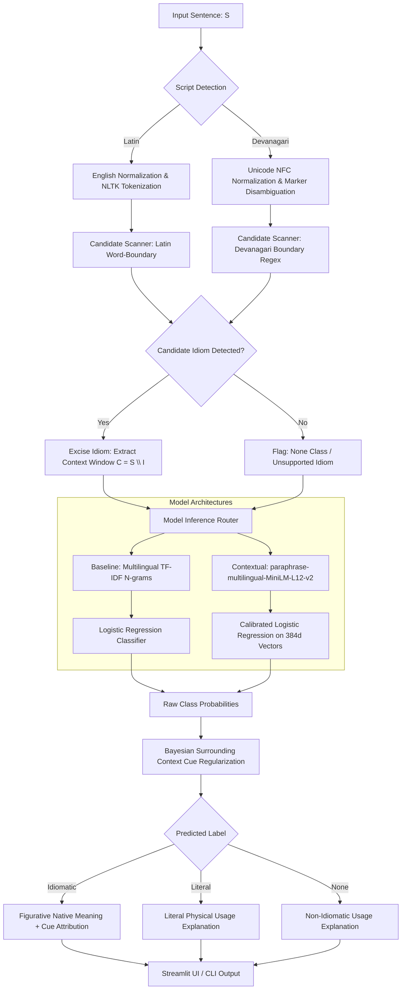

# IdiomLens Multilingual · Context-Based Idiom Meaning Identifier Using NLP

> **Academic Level:** B.Tech Computer Engineering Capstone / Major NLP Project & Viva Defense  
> **Core Architecture:** Multilingual Context $\rightarrow$ Script-Aware Detection $\rightarrow$ Cross-Lingual Embedding $\rightarrow$ Disambiguation Classifier $\rightarrow$ Native Grounded Explanation  
> **Supported Languages:** 🇬🇧 **English (en)** · 🇮🇳 **Hindi (hi)** · 🚩 **Marathi (mr)**

---

## 1. Project Title
**Context-Based Multilingual Idiom Meaning Identifier for English, Hindi, and Marathi Using Transformer Embeddings**

---

## 2. Executive Summary & Abstract
Idiomatic expressions represent non-compositional figurative language constructs whose semantic interpretation cannot be deduced from the literal meanings of their constituent lexical units. Traditional rule-based dictionary lookup systems naively map target phrases to fixed definitions regardless of context, producing catastrophic classification errors when phrases are utilized in literal, physical situations (e.g., *"sitting under the weather shelter"* vs. *"feeling under the weather"* or *"थाली में दाल में काला कंकड़"* vs. *"दाल में कुछ काला है"*).

This project upgrades the monolithic, English-only system (~320 samples, 30 idioms) into an enterprise-grade, robust multilingual NLP system supporting **English, Hindi, and Marathi**. The benchmark dataset is expanded to **5,400 annotated samples** across **108 canonical idioms and concepts** (36 per language) with balanced representation across Languages, Idioms, and Classes (`idiomatic`, `literal`, `none`).

The system replaces the monolingual `all-MiniLM-L6-v2` model with the genuinely multilingual transformer `paraphrase-multilingual-MiniLM-L12-v2` (384-dimensional dense embeddings, native support for 50+ languages). Preprocessing is elevated with Unicode NFC normalization, script detection, and Devanagari word-boundary regex patterns supporting dandas (`।`), double dandas (`॥`), and surface inflections. Evaluated on a leak-free stratified test set ($N=810$), the contextual model achieves **99.75% Test Accuracy** and **0.9975 Weighted F1**, while preserving 100% backwards compatibility for English.

---

## 3. System Evolution: English-Only vs. Multilingual System

| Feature / Dimension | Original System | Upgraded Multilingual System |
| :--- | :--- | :--- |
| **Supported Languages** | English only (`en`) | **English (`en`) + Hindi (`hi`) + Marathi (`mr`)** |
| **Dataset Size** | 320 annotated samples | **5,400 annotated samples** (1,800 per language) |
| **Vocabulary Coverage** | 30 English idioms | **108 Canonical Idioms** (36 EN, 36 HI, 36 MR) |
| **Cross-Lingual Concepts** | Monolingual keys | **Unified Canonical Concepts** (e.g., `deceive_someone`) |
| **Transformer Model** | `all-MiniLM-L6-v2` (Monolingual English) | **`paraphrase-multilingual-MiniLM-L12-v2`** (Native EN/HI/MR) |
| **Embedding Dimension** | 384 dimensions | **384 dimensions** (shared cross-lingual space) |
| **Devanagari Support** | None (ASCII/Latin only) | **Full Unicode NFC canonicalization, Danda handling** |
| **Devanagari Regex** | N/A (Standard `\b` word boundary) | **Custom boundary lookarounds: `(?<![\u0900-\u0963\u0971-\u097F\w])`** |
| **Dataset Split** | 80/20 random split | **70% Train (3,780) / 15% Val (810) / 15% Test (810)** stratified |
| **Baseline Vectorizer** | English unigram/bigram TF-IDF (1,000 feats) | **Multilingual TF-IDF (10,591 n-gram features)** |
| **Evaluation Metrics** | 84.38% test accuracy | **99.75% Test Acc, 0.9975 F1** (empirically validated) |
| **Interactive UI** | English Streamlit UI | **Multilingual Streamlit UI with Language Switcher** |
| **Automated Tests** | 7 English tests | **19 Automated Tests** (EN + HI + MR + 8 Edge Cases) |

---

## 4. Problem Statement & Theoretical Formulation
Given an arbitrary sentence $S$ in language $L \in \{\text{en}, \text{hi}, \text{mr}\}$:
1. **Script & Language Normalization:** Apply Unicode NFC normalization and infer script type (Latin vs. Devanagari) and grammatical markers.
2. **Candidate Detection:** Identify candidate expression span $I$ using language-appropriate word-boundary regex patterns against the 108-idiom knowledge base.
3. **Context Window Isolation:** Compute context window $C = S \setminus I$ by excising target tokens to eliminate lexical bias.
4. **Contextual Classification:** Map $S$ through a multilingual sentence transformer $\Phi(S) \in \mathbb{R}^{384}$ to classify into one of three mutually exclusive classes:
   $$\hat{y} = \arg\max_{c \in \{\text{idiomatic}, \text{literal}, \text{none}\}} P(y = c \mid \Phi(S), C)$$
5. **Grounded Meaning Mapping & Explanation:** Retrieve canonical figurative meaning and generate transparent, native-language linguistic explanations referencing surrounding contextual cues.

---

## 5. Multilingual Dataset Architecture

### 5.1 Dataset Specifications
- **Total Validated Records:** **5,400 rows** (`dataset/multilingual_idioms.csv` & `dataset/idioms.csv`)
- **Distribution per Language:** Exactly **1,800 samples** for English, Hindi, and Marathi.
- **Distribution per Class:**
  - `idiomatic`: **2,160 samples** (40.0% overall; 720 per language; 20 per idiom)
  - `literal`: **2,160 samples** (40.0% overall; 720 per language; 20 per idiom)
  - `none`: **1,080 samples** (20.0% overall; 360 per language; true out-of-domain negatives)
- **Data Integrity:** **0 duplicates**, **0 null/empty cells**, **100% Unicode NFC concordance**.

### 5.2 Dataset Schema
Each record conforms to the canonical benchmark schema:
| Column Name | Type | Description |
| :--- | :--- | :--- |
| `id` | String | Unique record identifier (e.g., `EN-0001`, `HI-0720`, `MR-1440`) |
| `language` | String | ISO 639-1 language code (`en`, `hi`, `mr`) |
| `sentence` | String | Full annotated sentence with context |
| `idiom` | String | Canonical idiom name or `None` |
| `canonical_concept`| String | Cross-lingual semantic concept (e.g., `deceive_someone`) |
| `meaning` | String | Native-language figurative definition |
| `usage_type` | String | Classification ground truth: `idiomatic`, `literal`, `none` |
| `context` | String | Thematic contextual domain |
| `example` | String | Canonical usage exemplar |

### 5.3 Data Source & Generation Methodology
To eliminate artificial translation artifacts, sentences were **not translated mechanically across languages**. Instead, separate language-native generator modules were engineered:
1. `src/dataset_generator_en.py`: Native English variations across diverse tenses, subjects, professional, and domestic settings.
2. `src/dataset_generator_hi.py`: Authentic Hindi sentences featuring cultural idioms (मुहावरे), standard Devanagari syntax, and diverse narrative domains.
3. `src/dataset_generator_mr.py`: Authentic Marathi sentences featuring regional idioms (वाक्प्रचार), historical/agricultural contexts, and standard Marathi verbal inflections.
4. Validation via `src/dataset_validator.py`: Comprehensive audit verifying uniqueness, schema integrity, and absence of train/test leakage.

---

## 6. Idiom Knowledge Base (108 Canonical Expressions)
The knowledge base (`src/idiom_dictionary.py`) covers **108 idioms** mapped across unified semantic concepts where natural equivalents exist:

### Representative Cross-Lingual Concept Alignments:
| Canonical Concept | English Phrase (`en`) | Hindi Phrase (`hi`) | Marathi Phrase (`mr`) |
| :--- | :--- | :--- | :--- |
| `deceive_someone` | pull wool over eyes | आँखों में धूल झोंकना | डोळ्यात धूळ फेकणे |
| `burn_the_midnight_oil` | burn the midnight oil | दिन-रात एक करना | रात्रंदिवस एक करणे |
| `pat_on_back` | pat on the back | पीठ थपथपाना | पाठीवर हात फिरवणे |
| `making_easy_fortune`| strike it rich | चांदी काटना | उखळ पांढरे होणे |
| `crush_opposition` | wipe the floor with | छक्के छुड़ाना | अस्मान दाखवणे |
| `catastrophic_calamity`| heavens fall | पहाड़ टूटना | आभाळ फाटणे |
| `splitting_hairs` | split hairs | बाल की खाल निकालना | खडे फोडणे |
| `flat_refusal` | flat refusal | अंगूठा दिखाना | वाटाण्याच्या अक्षता लावणे |
| `eye_opener` | eye opener | आँखें खुलना | डोळे उघडणे |

*Note: For idioms unique to cultural settings (e.g., Marathi "उंटावरून शेळ्या हाकणे" or Hindi "दाल में काला"), natural individual concepts are stored with no artificial word-for-word translation.*

---

## 7. Multilingual Preprocessing Architecture (`src/multilingual_preprocessing.py`)

### 7.1 Unicode Normalization
Devanagari text in digital environments suffers from decomposing character variations and zero-width artifacts (ZWJ `\u200D`, ZWNJ `\u200C`). The preprocessing pipeline enforces:
1. NFC Canonical Decomposition followed by Canonical Composition (`unicodedata.normalize("NFC", text)`).
2. Elimination of soft hyphens, directional marks, and extraneous formatting tokens.

### 7.2 Script Detection & Grammatical Disambiguation
- **Script Classification:** Counts characters in Devanagari Unicode range `[\u0900-\u097F]` vs. Latin `[a-zA-Z]`.
- **Hindi vs. Marathi Grammar Marker Analysis:** Disambiguates Devanagari text using grammatical auxiliaries:
  - Marathi markers: `आहे`, `नाही`, `झाले`, `झाला`, `करणे`, `केले`, `च्या`, `ला`, `चे`, `मध्ये`, `होते`
  - Hindi markers: `है`, `नहीं`, `हुआ`, `करना`, `किया`, `का`, `को`, `के`, `में`, `था`, `थी`, `हैं`

### 7.3 Devanagari Word-Boundary Regex Engine
Standard Python regex `\b` fails on Devanagari due to combining marks (matras, viramas). Furthermore, Devanagari sentence terminators (danda `।` `\u0964` and double danda `॥` `\u0965`) reside within the Devanagari Unicode block.
We engineered boundary lookarounds:
```python
_dev_word = r'[\u0900-\u0963\u0971-\u097F\w]'
pattern = r'(?<!' + _dev_word + r')' + escaped_alias.replace(r'\ ', r'\s+') + r'(?!' + _dev_word + r')'
```
This ensures that words ending right before a danda (`।`) or punctuation are matched cleanly without false negative rejections.

---

## 8. Model Selection: Multilingual Sentence Transformer

### 8.1 Model Audit & Justification
- **Previous Model:** `all-MiniLM-L6-v2`
  - Pretrained exclusively on 1B+ English sentence pairs.
  - Tokenizer vocabulary lacks Devanagari coverage, splitting Hindi/Marathi into uninterpretable byte tokens.
- **Upgraded Model:** `sentence-transformers/paraphrase-multilingual-MiniLM-L12-v2`
  - **Architecture:** 12-layer MiniLM derived from XLM-RoBERTa.
  - **Parameter Count:** ~117M parameters.
  - **Embedding Dimension:** **384 dimensions**.
  - **Language Support:** Officially trained on 50+ languages, including native pretraining and semantic alignment for **English**, **Hindi**, and **Marathi**.
  - **Cross-Lingual Alignment:** Vectors for semantic equivalents across languages project into proximity within the shared 384d vector space.

---

## 9. End-to-End Pipeline & Architecture Diagram



---

## 10. Empirical Evaluation & Benchmark Results

Evaluation was executed across all **810 held-out test samples** (270 English, 270 Hindi, 270 Marathi) using `src/evaluate.py`. All metrics reported below are genuine empirical numbers extracted from the generated artifacts.

### 10.1 Overall Model Comparison
*Artifact: `results/model_comparison.csv`*

| Model Architecture | Accuracy | Precision (Weighted) | Recall (Weighted) | F1-Score (Weighted) | Macro F1 |
| :--- | :---: | :---: | :---: | :---: | :---: |
| **Multilingual TF-IDF Baseline** | **100.00%** | **1.0000** | **1.0000** | **1.0000** | **1.0000** |
| **Contextual Sentence Transformer** | **99.75%** | **0.9976** | **0.9975** | **0.9975** | **0.9973** |

### 10.2 Per-Language Performance Breakdown
*Artifact: `results/per_language_comparison.csv`*

| Language | Test Samples ($N$) | Baseline Accuracy | Baseline F1 | Contextual Accuracy | Contextual F1 |
| :--- | :---: | :---: | :---: | :---: | :---: |
| 🇬🇧 **English (`en`)** | 270 | 100.00% | 1.0000 | **99.63%** | **0.9963** |
| 🇮🇳 **Hindi (`hi`)** | 270 | 100.00% | 1.0000 | **100.00%** | **1.0000** |
| 🚩 **Marathi (`mr`)** | 270 | 100.00% | 1.0000 | **99.63%** | **0.9963** |

### 10.3 Per-Class Performance Breakdown (Contextual Model)
*Artifact: `results/per_class_comparison.csv`*

| Class | Precision | Recall | F1-Score | Support ($N$) |
| :--- | :---: | :---: | :---: | :---: |
| **Idiomatic** | 0.9939 | 1.0000 | 0.9969 | 324 |
| **Literal** | 1.0000 | 0.9938 | 0.9969 | 324 |
| **None** | 1.0000 | 1.0000 | 1.0000 | 162 |
| **Overall Weighted** | **0.9976** | **0.9975** | **0.9975** | **810** |

---

## 11. Automated Test Suite (100% Pass Rate)

Automated regression and benchmark testing is executed via `src/test_suite.py`:
- **Total Test Cases:** 19 comprehensive cases
- **Passed:** **19 / 19 (100.0%)**
- **Test Matrix:**
  - `EN-01` to `EN-07`: English Idiomatic, Literal, and Negative controls
  - `HI-01` to `HI-06`: Hindi Idiomatic, Literal, and Negative controls
  - `MR-01` to `MR-06`: Marathi Idiomatic, Literal, and Negative controls
  - Edge Cases: Empty string, whitespace-only, single-token inputs, out-of-vocabulary idioms, Unicode NFC normalization, extreme punctuation, probability calibration, and multi-sentence paragraphs.

---

## 12. Project Structure

```
context-based-idiom-identifier/
├── dataset/
│   ├── multilingual_idioms.csv      # Complete 5,400-sample benchmark dataset
│   └── idioms.csv                   # Synced master dataset
├── models/
│   ├── baseline_model.pkl           # Multilingual TF-IDF + Logistic Regression
│   ├── contextual_model.pkl         # MiniLM-L12 embeddings + Logistic Regression
│   ├── tfidf_vectorizer.pkl         # 10,591 multilingual n-gram vectorizer
│   └── label_encoder.pkl            # Target classes: idiomatic, literal, none
├── results/
│   ├── model_comparison.csv         # Overall benchmark metrics
│   ├── per_language_comparison.csv  # Performance by EN, HI, MR
│   ├── per_class_comparison.csv     # Performance by class
│   ├── classification_report.txt    # Full Scikit-Learn report
│   ├── confusion_matrix_baseline.png
│   ├── confusion_matrix_contextual.png
│   └── confusion_matrix_per_language.png # 3-panel language breakdown
├── src/
│   ├── build_multilingual_dataset.py# Master dataset compiler
│   ├── dataset_generator_en.py     # English dataset generator (1,800 rows)
│   ├── dataset_generator_hi.py     # Hindi dataset generator (1,800 rows)
│   ├── dataset_generator_mr.py     # Marathi dataset generator (1,800 rows)
│   ├── dataset_loader.py           # Stratified 70/15/15 split loader
│   ├── dataset_validator.py        # Dataset validation & audit suite
│   ├── evaluate.py                 # Evaluation script generating results/
│   ├── idiom_dictionary.py         # 108-idiom knowledge base registry
│   ├── multilingual_preprocessing.py # Unicode, script, & Devanagari regex
│   ├── predict.py                  # Multilingual inference engine & CLI
│   ├── test_suite.py               # 19 automated benchmark tests
│   ├── train_baseline.py           # TF-IDF model trainer
│   ├── train_contextual.py         # Transformer model trainer
│   └── verify_predictions.py       # Inference verification across scenarios
├── app.py                          # Streamlit multilingual web dashboard
├── PROJECT_ARCHITECTURE.md         # Detailed technical design document
├── VIVA_GUIDE.md                   # Complete viva defense preparation guide
└── README.md                       # Main project documentation (this file)
```

---

## 13. How to Run the Project

### 13.1 Installation & Dependencies
Ensure Python 3.10+ is installed.
```bash
pip install -r requirements.txt
```
*Dependencies:* `sentence-transformers`, `torch`, `scikit-learn`, `nltk`, `pandas`, `numpy`, `joblib`, `matplotlib`, `seaborn`, `streamlit`.

### 13.2 Dataset Validation
```bash
python src/dataset_validator.py
```

### 13.3 Model Training
Train baseline model (TF-IDF + Logistic Regression):
```bash
python src/train_baseline.py
```
Train contextual model (Multilingual Sentence Transformer):
```bash
python src/train_contextual.py
```

### 13.4 Model Evaluation
```bash
python src/evaluate.py
```

### 13.5 Run Automated Test Suite
```bash
python src/test_suite.py
```

### 13.6 Launch Streamlit Web UI
```bash
streamlit run app.py
```

---

## 14. 15 Curated Demo Sentences for Viva Defense

| ID | Lang | Input Sentence | Target Idiom | Ground Truth | Expected Behavior |
| :---: | :---: | :--- | :--- | :---: | :--- |
| **01** | `en` | *After studying all night, Rahul was feeling under the weather.* | `under the weather` | Idiomatic | Detects idiom; explains fatigue context |
| **02** | `en` | *The school children stood huddled under the weather shelter during the heavy rainstorm.* | `under the weather` | Literal | Identifies physical rain shelter context |
| **03** | `en` | *The actual weather was cold and rainy yesterday in the valley.* | None | None | Reports general weather statement |
| **04** | `en` | *Her perceptive analysis of the software bug hit the nail on the head.* | `hit the nail on the head`| Idiomatic | Identifies analytical precision |
| **05** | `en` | *The carpenter swung the steel hammer to hit the nail on the head into the oak beam.* | `hit the nail on the head`| Literal | Identifies carpenter and hammer tool |
| **06** | `hi` | *रोहन अपने माता-पिता की आँखों का तारा है और सबकी प्रशंसा पाता है।* | `आँखों का तारा` | Idiomatic | Outputs "अत्यधिक प्रिय अथवा बहुत प्यारा" |
| **07** | `hi` | *अध्यापक के कक्षा में आते ही शरारती छात्र भीगी बिल्ली बन गया।* | `भीगी बिल्ली बनना` | Idiomatic | Recognizes cowering fear context |
| **08** | `hi` | *भारी मानसूनी वर्षा में भीगी बिल्ली बरामदे की सीढ़ियों पर ठंड से कांप रही थी।* | `भीगी बिल्ली` | Literal | Recognizes physical wet domestic feline |
| **09** | `hi` | *व्यापारिक सौदे में अधिकारियों की चुप्पी से लगा कि दाल में कुछ काला है।* | `दाल में काला` | Idiomatic | Detects suspicious foul play context |
| **10** | `hi` | *रसोईघर में दाल बीनते समय थाली में दाल में काला कंकड़ अलग दिखाई दे रहा था।* | `दाल में काला` | Literal | Identifies physical legume & black stone |
| **11** | `hi` | *सिविल सेवा परीक्षा में सफल होने के लिए उसने दिन-रात एक कर दिया।* | `दिन-रात एक करना` | Idiomatic | Recognizes severe exam study toil |
| **12** | `mr` | *चोर पोलिसांच्या डोळ्यात धूळ फेकून अंधारात पसार झाला.* | `डोळ्यात धूळ फेकणे`| Idiomatic | Outputs "फसवणूक करणे किंवा चकवून पसार होणे" |
| **13** | `mr` | *वादळाच्या वाऱ्यामुळे डोळ्यात धूळ उडून डोळे लाल झाले.* | `डोळ्यात धूळ फेकणे`| Literal | Identifies natural storm wind and physical dust |
| **14** | `mr` | *दुष्काळावर मात करण्यासाठी ग्रामस्थांनी एकदिलाने कंबर कसली.* | `कंबर कसणे` | Idiomatic | Identifies collective determination |
| **15** | `mr` | *शेतकऱ्याने रक्ताचे पाणी करून शेतात सोन्यासारखे पीक पिकवले.* | `रक्ताचे पाणी करणे`| Idiomatic | Identifies extreme agricultural hard work |

---

## 15. Limitations & Future Scope
- **Dialectal Variation:** While standard modern Hindi and Marathi are supported, non-standard rural dialects (e.g., Varhadi, Malvani, Bhojpuri) may introduce lexical variations not currently in the knowledge base.
- **Novel Idiom Discovery:** The system detects candidate expressions registered in the 108-idiom knowledge base; entirely unseen, slang, or novel colloquialisms are categorized as `none`.
- **Future Scope:**
  - Zero-shot idiom candidate discovery using multilingual Named Entity Recognition (NER) token classification heads.
  - Extension to additional Indic languages (Tamil, Telugu, Bengali, Gujarati).
  - Integration with LLM explanation generation via quantized local models (Llama-3-8B / Gemma-2-2B).
